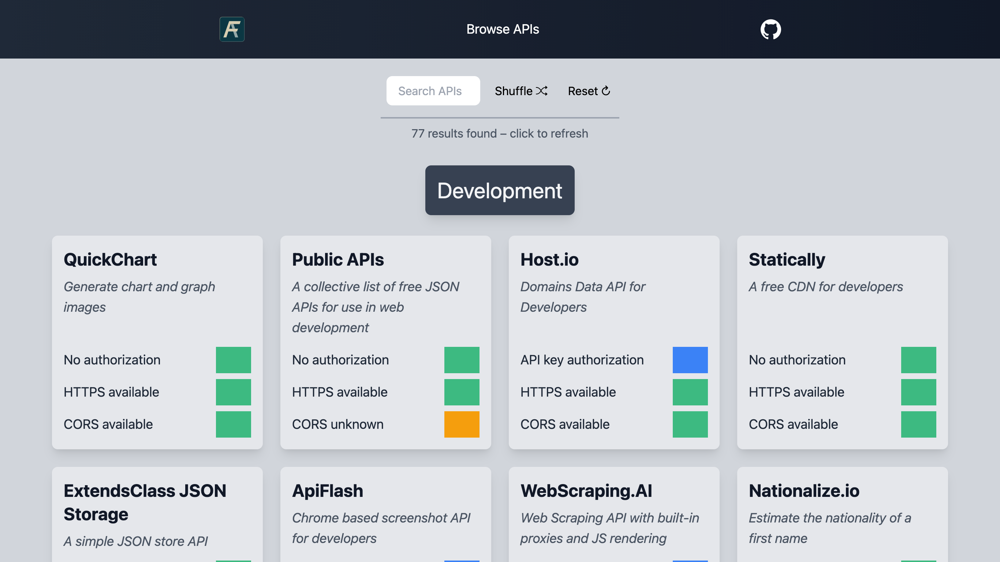

# [Free APIs](https://free-apis.github.io)

_A collection of free APIs for new and experienced developers, derived from [Public APIs](https://github.com/public-apis/public-apis)._

This project was built in React.js using [Create React App](https://github.com/facebook/create-react-app) and [Tailwind CSS](https://tailwindcss.com) for styling.

## Quick Overview of Free APIs

• Free APIs offers a fast website with a comprehensive list of APIs.

• View All APIs:

    • Ideal for discovering new project ideas.

    • Helps in checking **CORS**, **HTTPS**, and **Authorization** methods.

• View by Category:

    • Allows for more targeted searches and browsing.

    • Each card links to the respective API documentation or website.

_That's the ultimate goal._

• The site aims to be a quick resource for finding APIs and inspiration for projects.

• Feedback is welcome via
[**open a GitHub issue**](https://github.com/Free-APIs/Free-APIs.github.io/issues)

• For inquiries, users are encouraged to reach out [**feel free to reach out!**](mailto:freeapis256@gmail.com?subject=Hey%20there!)

### Check out the website [_here_](https://free-apis.github.io) for more information.
